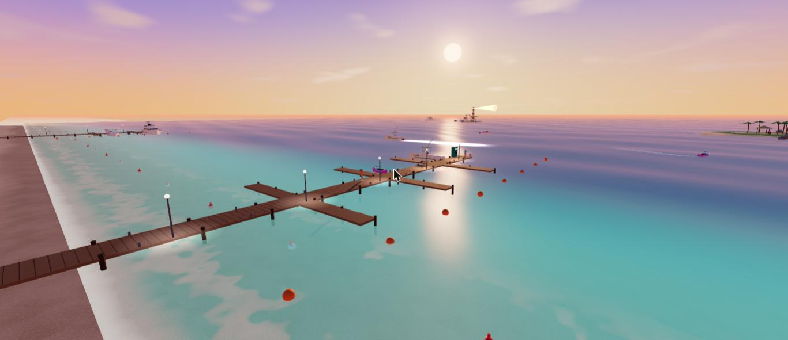
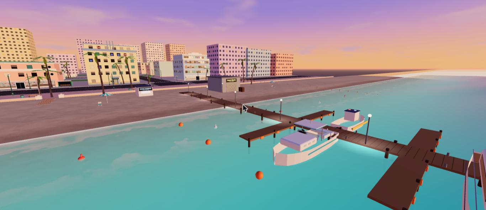
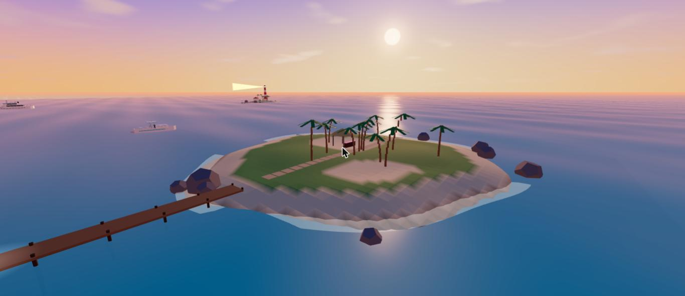
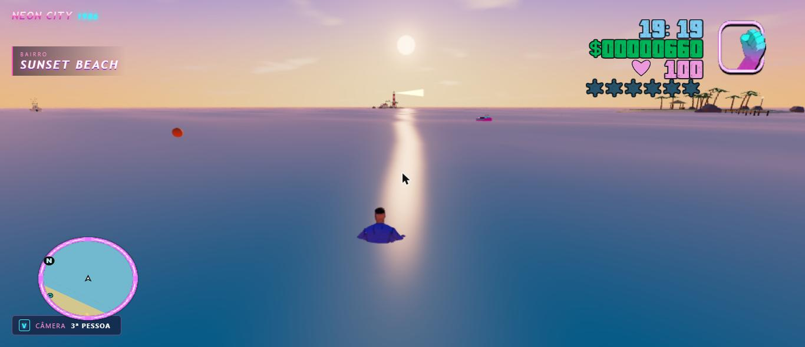
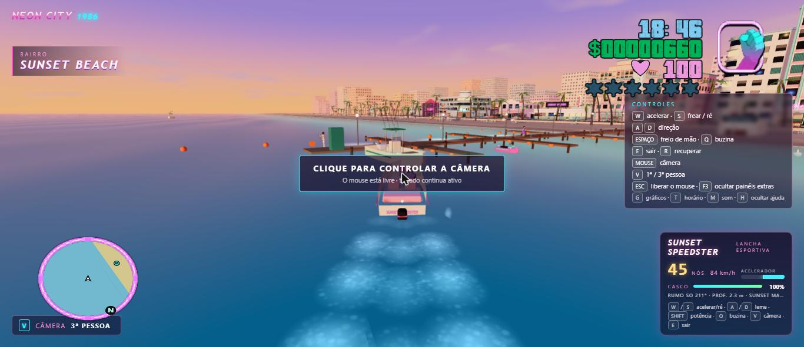

# OCEAN DRIVE — mar navegável, barcos, marinas, ilhas e natação (PROMPT 11)

Sistema marítimo original de NEON CITY: 1986. Nenhum modelo, textura, som,
código ou nome de jogo de terceiros foi usado: barcos, píeres, ilhas, farol
e sons são procedurais (Three.js + Web Audio).

## 1. Diagnóstico inicial

- O oceano era só visual: `world/Ocean.js` desloca vértices com três ondas
  senoidais amortecidas pela profundidade da praia (`BEACH` em `Terrain.js`).
- Uma parede invisível (`bound_water`, x 110–130) impedia entrar no mar; o
  jogador recebia "Águas profundas — volte para a areia" a partir de x≈110.
- Não havia natação, barcos, física de flutuação nem locais no mar.
- Carros já bloqueiam em água com mais de 0,75 m (`VehiclePhysics`), o que
  permitiu remover a parede sem deixar carros entrarem no mar.

## 2. Arquitetura

| Módulo | Papel |
|---|---|
| `src/water/WaterSurface.js` | Altura da água idêntica à desenhada (mesmas ondas e a mesma triangulação da malha do oceano), fundo do mar e relevo das ilhas |
| `src/water/WaterManager.js` | Abre o mar (remove só `bound_water`, cria limites ao largo), integra ilhas ao terreno/profundidade do ambiente, constrói marinas/ilhas, LOD |
| `src/water/WaterEffects.js` | Espuma/esteira/respingos com pool fixo (1 InstancedMesh, 240 partículas) |
| `src/maritime/MaritimeLocations.js` | SUNSET MARINA, AZURE DOCKS, CORAL ISLAND, HIDDEN COVE, LIGHTHOUSE POINT (kit modular dos interiores) |
| `src/maritime/MaritimeTraffic.js` | IA marítima: rotas e estados |
| `src/maritime/MarinaNPCs.js` | Frequentadores das marinas reaproveitando `InteriorNPCs` |
| `src/boats/BoatDefinitions.js` | Dados dos 5 barcos (+ lancha da NCPD) |
| `src/boats/BoatFactory.js` | Modelos procedurais (casco em V por seções) |
| `src/boats/BoatPhysics.js` | Flutuação em 4 pontos, empuxo, arrasto, leme, encalhe, colisões |
| `src/boats/BoatAudio.js` | Motor, casco na água, buzina, respingo, impacto, marulho |
| `src/boats/BoatManager.js` | Embarque/desembarque, controles, câmera, HUD, loja, MARINA STORAGE, save, dano |
| `src/ui/BoatHUD.js` | Painel náutico |
| `src/dev/OceanSuite.js` | Os 45 testes obrigatórios executados no jogo real (dev) |
| `tools/ocean/ocean.test.mjs` | Testes Node (`npm run test:ocean`) |

Ordem no quadro (`Game.step`): interiores → customs → **barcos (entrada/E)** →
veículos → jogador → cidade → mundo (oceano atualiza `uTime`) → **água e
barcos** (mesmo `uTime` do quadro desenhado) → câmeras → **câmera náutica**.

Só no mapa procedural: em TEST CITY (`env.isImported`) água e barcos ficam
inativos e invisíveis; o ambiente importado não recebe nenhum dos ganchos.

## 3. Sistema de água

- **Sincronização exata com a tela**: o vertex shader só move os vértices da
  malha (620×1100 m, 124×74 células) e a GPU interpola cada triângulo.
  `WaterSurface.height()` reproduz as ondas nos vértices **e** a diagonal
  dos triângulos do `PlaneGeometry`; o teste Node compara com a geometria
  real do Three.js (erro < 0,0001 m). O relógio é o mesmo `uTime`.
- Fora da malha o mar distante é plano, como o anel distante do shader.
- **Ilhas** elevam o fundo com uma única função (`addIsland().floor`) usada
  pela colisão (`collision.setTerrain`), pela profundidade (`env.waterDepth`),
  pela superfície de passos (`getSurface`) e pela malha visual.
- Limites: mar navegável até x=600, entre os limites norte/sul do bairro.
  Aviso "Limite da baía" substitui "Águas profundas" quando o mar está aberto.

## 4. Física aquática (`BoatPhysics`)

- Passo fixo 1/60 s, até 6 subpassos por quadro.
- **Flutuação**: proa, popa, bombordo e boreste amostram a superfície; a
  média define a altura (mola-amortecedor), as diferenças definem arfagem e
  balanço. Fora da água: só gravidade (saltos). Ao planar, o casco sobe
  (35% do calado) e a proa empina.
- **Propulsão**: só com a popa submersa; arrasto quadrático calibrado para a
  velocidade máxima + arrasto linear leve; deriva lateral amortecida; giro
  dependente da velocidade (mínimo de manobra parado); inclinação na curva.
- **Ré como freio**: andando para a frente, a ré usa 65% do empuxo.
- **Fundo raso**: encalhe com atrito forte; **terra seca** à frente para o
  casco como parede (com dano pelo impacto).
- **Colisões**: OBB do `CollisionSystem` contra píeres, estacas, rochas,
  quiosques, limites e outros barcos (colisor próprio por barco, impulso e
  atrito); a camada de interiores em y=300 nunca é alcançada.
- **Dano**: impactos acima de 3 m/s, proporcional à massa; casco escurece;
  em 0% o barco afunda — o do jogador é rebocado ao armazém (precisa de
  reparo), os atracados reaparecem na vaga depois de 60 s.

## 5. Embarcações

| Barco | Tipo | Preço | Vel. máx. medida* | Características |
|---|---|---|---|---|
| SUNSET SPEEDSTER | Lancha esportiva branca e azul | $18.000 | ~87 km/h | 2 assentos, para-brisa, faixa azul |
| OCEAN RUNNER | Lancha de cabine | $42.000 | ~67 km/h (teórico) | cabine com vigias, hardtop |
| PALM FISHER | Barco de pesca | $12.000 | ~48 km/h (teórico) | console central, T-top, varas, viveiro |
| NEON WAVE | Jet ski retrô | $6.500 | ~80 km/h (teórico) | selim, guidão, filete neon |
| AZURE YACHT | Iate | $160.000 | ~52 km/h (teórico) | dois conveses, flybridge, radar |
| NCPD HARBOR | Patrulha | — | — | só atracada na base (não pilotável) |

\* Medido no jogo: SPEEDSTER 85–87 km/h. Os demais foram validados pelo
teste Node (cada modelo chega a 75–110% da velocidade de projeto em 10 s).

Atracados no início: SPEEDSTER, NEON WAVE e PALM FISHER na Sunset Marina;
OCEAN RUNNER, AZURE YACHT e a lancha da NCPD em Azure Docks. Podem ser
usados como os carros estacionados (sem crime, igual aos carros).

## 6. Marinas

- **SUNSET MARINA** (píer em z=−120, da areia até x=152): rampa, deque com
  tábuas, estacas com colisão, postes com luz, três dedos com seis vagas,
  defensas, boias, escritório com letreiro neon e **loja de barcos**,
  quiosque **MARINA STORAGE** na ponta do píer, NPCs (marinheiro, pescador,
  turista, atendente).
- **AZURE DOCKS** (píer em z=−282): dois dedos, armazém com letreiro,
  segundo acesso à **MARINA STORAGE**, NPCs (estivador, pescador, vigia) e
  a **base NCPD HARBOR PATROL** (quiosque + lancha atracada).

## 7. Ilhas

| Ilha | Posição | Destaques |
|---|---|---|
| CORAL ISLAND | (300, −40), r 26 | palmeiras, trilha, bar de praia abandonado, píer |
| HIDDEN COVE | (330, 120), r 22 | enseada rasa e abrigada, abrigo de pescadores, píer |
| LIGHTHOUSE POINT | (420, −240), r 16 | farol listrado com facho giratório, casa do faroleiro, píer |

Todas têm píer de desembarque até água funda, ponto de atracação ao lado da
ponta do píer, chão caminhável (o mesmo relevo da colisão), rochas e
palmeiras com colisão, espuma acompanhando a linha d'água real e um ponto
de interesse (E) com texto.

## 8. Natação (estado SWIMMING)

- Começa quando o fundo passa de 1,3 m (andando praia adentro, caindo do
  píer ou saindo do barco no mar); termina quando o pé toca o fundo (1,18 m).
- Flutua acompanhando a onda (corpo 1,22 m abaixo da superfície), 2,0 m/s
  (3,1 com Shift), sem pulo e sem armas; colide com estacas e cascos e passa
  por baixo dos deques.
- **Espaço** perto de píer/convés baixo sobe para fora da água — nadando ou
  com água no peito.
- Pose procedural de braçada; câmera de 3ª pessoa elevada 0,85 m na água.

## 9. IA marítima

Quatro barcos (OCEAN RUNNER, AZURE YACHT, PALM FISHER, NEON WAVE) em rotas
fechadas pela baía, com estados:

| Estado | Comportamento |
|---|---|
| `cruise` | segue os waypoints em velocidade de cruzeiro |
| `yield` | obstáculo no cone à frente: reduz; acima da velocidade segura, ré proporcional |
| `stop` | obstáculo a menos de 6 m: ré até parar |
| `detour` | obstáculo **parado** bloqueando por 4 s: ré reta, abre folga lateral, segue paralelo e só volta à rota depois de passar |
| `reverse` | preso sem avançar: ré curta |
| `wait` | parada programada (mirante, pesca) |
| `far` | longe da câmera (> 260 m): simulação simplificada sem colisão nem espuma |

Rotas verificadas por amostragem: folga mínima de 1,2 m sob a quilha (não
atravessam ilhas nem raspam o fundo).

## 10. Áudio (procedural)

Motor (dois osciladores + "borbulhar" de descarga molhada, filtro pela
carga), casco cortando a água (ruído rosa pela velocidade), buzina marítima
grave (Q), respingo (entrar na água, pouso de salto), batida de casco
(impacto) e **marulho da marina** perto dos píeres. A automação só é enviada
quando o valor muda de forma perceptível (sem custo por quadro).

## 11. Efeitos visuais

Esteira de espuma pelos dois cantos da popa (abre para fora), espuma central
em alta velocidade, "bigodes" de respingo na proa, respingos de impacto e de
pouso, anel de espuma animado nas ilhas, facho do farol, poças de luz nos
píeres (intensas à noite).

## 12. Economia

Compras pela `EconomyManager` (txId único por compra): loja da Sunset Marina
(jet ski $6.500 … iate $160.000), reparo no armazém ($12 por ponto de casco).
Saldo insuficiente bloqueia a compra sem alterar o saldo.

## 13. Persistência

Seção `boats` no save (só dados simples): `{ owned: [{ pid, type, name, hp,
location: 'storage'|'world', x, z, heading }], aboard }`.
- Validação: barco duplicado é erro; modelo desconhecido vira aviso;
  posição obrigatória para `world`; saves antigos sem a seção continuam válidos.
- Restauração sem duplicar: remove os barcos do jogador da água e recria a
  partir do save; posição inválida devolve o barco ao armazém (aviso).
- Salvo pilotando: volta ao leme do mesmo barco.

## 14. Arquivos criados

`src/water/WaterSurface.js`, `src/water/WaterManager.js`, `src/water/WaterEffects.js`,
`src/maritime/MaritimeLocations.js`, `src/maritime/MaritimeTraffic.js`,
`src/maritime/MarinaNPCs.js`, `src/boats/BoatDefinitions.js`,
`src/boats/BoatFactory.js`, `src/boats/BoatPhysics.js`, `src/boats/BoatAudio.js`,
`src/boats/BoatManager.js`, `src/ui/BoatHUD.js`, `src/dev/OceanSuite.js`,
`tools/ocean/ocean.test.mjs`, `docs/OCEANO.md`, `docs/screenshots/oceano/*`.

## 15. Arquivos modificados (mudanças mínimas, nenhum sistema removido)

| Arquivo | Mudança |
|---|---|
| `core/Game.js` | cria água/barcos; ordem no quadro; marcadores; aviso de limite; novo jogo |
| `config.js` | parâmetros de natação do jogador |
| `player/PlayerController.js` | estado SWIMMING, subida em píer, lâmina d'água nos pés (deques não contam como água) |
| `player/Player.js`, `player/PlayerAnimator.js` | estado de nado e pose de braçada |
| `camera/ThirdPersonCamera.js` | pivô elevado nadando |
| `interiors/InteriorManager.js` | não mostra portas enquanto pilota um barco |
| `weapons/WeaponManager.js` | sem armas nadando |
| `ui/Minimap.js` | marcadores de marina (M) e barco próprio |
| `save/SaveManager.js`, `save/SaveSchema.js` | seção `boats` (coleta, validação, restauração) |
| `styles/main.css` | painel náutico |
| `dev/TestHarness.js` | `oceanSuite()` |
| `package.json` | `test:ocean` |

## 16. Testes executados

- **Bateria in-game** (`await __NEON_TEST__.oceanSuite()`): **45/45**, executada
  três vezes seguidas na mesma sessão (45/45, 45/45, 45/45) após as correções.
  Resultado detalhado de cada teste: `docs/screenshots/oceano/testes_ocean_drive.json`.
- **Node** `npm run test:ocean`: 5/5 (sincronia com a malha, ilhas/rotas,
  física dos 5 barcos, colisão/encalhe, validação do save).
- **Regressão**: cidade 8/8, assets 2/2, HUD 6/6, polícia 20/20, IA 9/9,
  customs 3/3, destruição 10/10. `vite build` sem erros.

## 17. Desempenho

- Água + barcos (11 barcos, IA, NPCs, espuma): **0,1 ms** mediana, 0,2 ms p95 por quadro.
- Construção da água/ilhas/marinas: 55–77 ms (uma vez por partida).
- Quadro completo com render perto da marina (perfil BAIXO, automação): ~17 ms mediana.
- Memória: após três baterias completas (barcos criados/descartados, ~19 mil partículas), geometrias 1039→1029 e texturas 135→135; heap JS 84 MB → 110 MB logo após a bateria → 87 MB depois da coleta de lixo (sem vazamento).
- LOD: locais além de 520 m ocultos; barcos além de 700 m ocultos; IA além de
  260 m em simulação simplificada; NPCs só com o jogador a menos de 95 m;
  partículas em pool fixo de 240 (sem alocação por quadro).

## 18–19. Bugs encontrados e corrigidos

| # | Bug (reproduzido) | Causa | Correção |
|---|---|---|---|
| 1 | Desembarque caía na água com o barco 1–2 m desalinhado do píer | só 10 pontos fixos de saída; píer da ilha tem 2,6 m | anel de 80 pontos ao redor do casco + atracação ao lado da ponta do píer |
| 2 | IA via o obstáculo mas batia nele | só cortava o motor (barco não tem freio) | ré proporcional à velocidade + alcance de detecção pela distância de parada |
| 3 | IA esperava para sempre atrás de barco parado | não havia contorno | estado `detour` |
| 4 | Primeira versão do contorno oscilava e raspava | o cone largo de detecção mantinha "obstáculo à frente" | emergência por distância real e ângulo; ré reta; avanço lento com o leme virado |
| 5 | Ré quase não freava em alta velocidade | hélice invertida a 32% do empuxo | ré como freio: 65% andando para a frente |
| 6 | Barco subia ~10 m na praia da ilha numa batida | o encalhe só empurrava o casco para cima | terra seca à frente para o casco como parede (com dano) |
| 7 | Velocidade final ~25% abaixo do projeto | arrasto linear alto | arrasto recalibrado (SPEEDSTER 85–87 km/h) |
| 8 | Barco seguia à deriva após reposicionamento | acelerador interno não era zerado | `place()` zera acelerador e leme |
| 9 | Empurrar contra o píer acumulava dano | limiar de impacto baixo | dano só acima de 3 m/s |
| 10 | Esteira virava "tapete" branco com anéis | textura vazada e alfa alto | mancha cheia e macia, alfa menor |
| 11 | Espuma das ilhas em arcos soltos | anel circular fixo | anel segue a linha d'água real (busca por ângulo) |
| 12 | Câmera rente à água ao nadar | pivô na altura dos pés | pivô elevado 0,85 m nadando |
| 13 | Impossível subir no píer com água no peito | subida só nadando | subida também com água ≥ 0,55 m |
| 14 | Jogador "na água" (lento) sobre píer com mar fundo embaixo | profundidade lida no fundo, não nos pés | lâmina d'água medida nos pés |
| 15 | Erro de sintaxe ao corrigir a espuma | interpolação do shell num patch | corrigido pelo editor (console limpo depois) |

## 20. Pendências reais

- Perseguição policial no mar: só a base (estrutura + lancha atracada). Sem viaturas marítimas operando.
- O AudioContext fica suspenso sob automação; a síntese foi verificada pela
  automação dos parâmetros, não por escuta.
- Barcos de IA não são "roubáveis" em movimento (só os atracados/parados).
